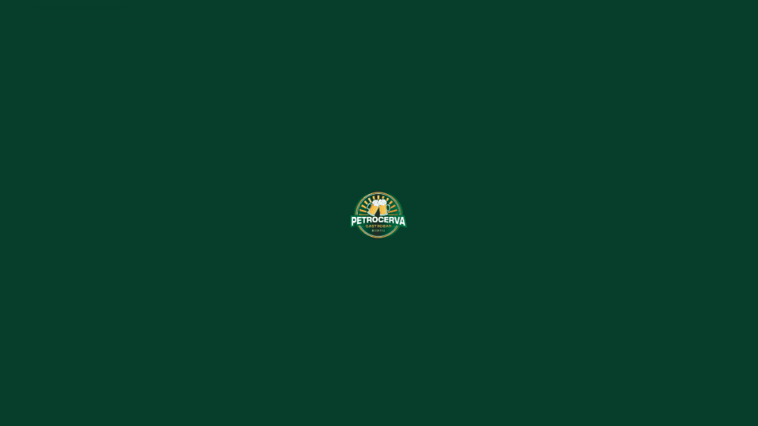
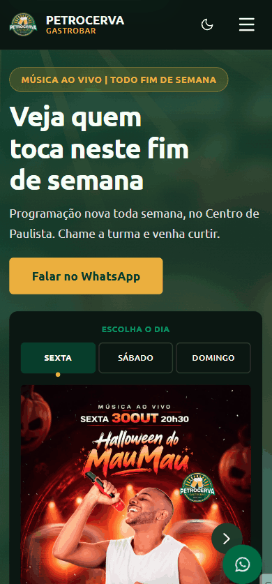

# Petrocerva Gastrobar

Site desenvolvido para o Petrocerva Gastrobar, localizado em Paulista, Pernambuco.

O projeto surgiu da necessidade de reunir a programação musical, o cardápio e as informações do estabelecimento em um único lugar, facilitando o acesso dos clientes pelo celular.

**[Acessar o site](https://www.petrocerva.com.br/)**

## Demonstração

O site apresenta uma programação semanal interativa, visualização ampliada dos eventos e animações que acompanham a navegação.

Clique em qualquer GIF para acessar o site.

### Desktop

  

  Navegação desktop - programação de eventos e interações da página.

### Mobile

  

  Navegação mobile - experiência responsiva em dispositivos móveis.

## Funcionalidades

- Programação semanal de música ao vivo
- Carrossel com os eventos em destaque
- Cardápio digital acessível por QR Code
- Informações sobre gastronomia
- Localização e integração com Google Maps
- Contato direto pelo WhatsApp
- Layout responsivo, com foco em dispositivos móveis

## Tecnologias

- HTML5
- CSS3
- JavaScript
- Vercel

## Desenvolvimento

Sou responsável pelo desenvolvimento, publicação e manutenção do site.

Além da implementação inicial, realizo atualizações semanais da programação e melhorias na navegação conforme as necessidades do estabelecimento.

O projeto também faz parte da minha experiência com desenvolvimento assistido por IA, utilizando ferramentas de geração e revisão de código durante a implementação.

## Desafios

Um dos principais desafios foi desenvolver uma interface que funcionasse bem em dispositivos móveis, já que grande parte do público acessa a programação pelo celular.

Outro ponto importante foi organizar a atualização frequente dos eventos, mantendo informações, imagens e links acessíveis aos clientes.

## Status

Projeto em produção, com manutenção e atualizações contínuas.
